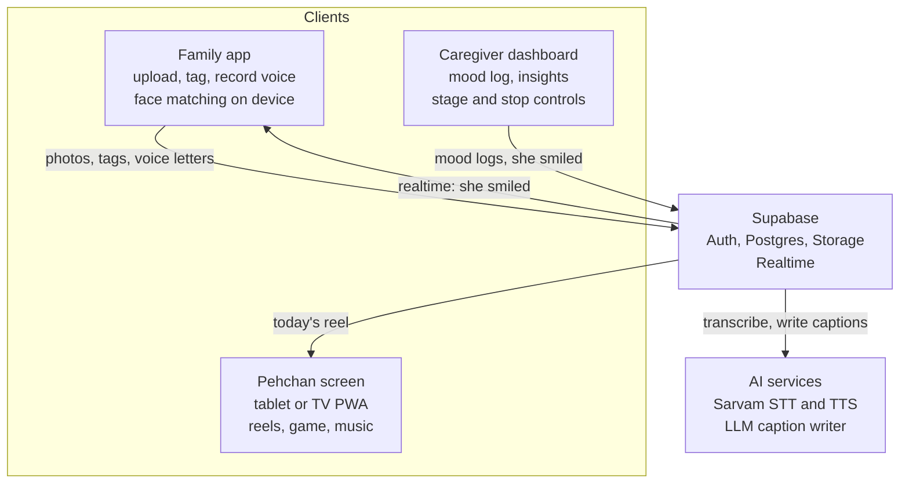

# Pehchan (पहचान) — Project Context for Claude Code

> Compiled 23 October 2026 from the team's research and brainstorming sessions.
> Read this whole file before writing code. Section 5 lists rules that must never be broken.

---

## 0. How to use this file

You are helping a small student team build **Pehchan**, a web app for people living with dementia and their families. It will be judged on three things: the pitch, an interactive demo, and a front end that looks exceptional. It must also be genuinely useful and ethically sound.

Priorities, in order:

1. Obey the non-negotiable product rules in **section 5**. They come from the research and they are the project's main differentiator.
2. Build the demo path first (section 12): the reel player, the gentle recognition game and the live "she smiled" loop. A demo that works on the first try beats a bigger feature list.
3. Make the elder-facing screen calm, slow, adult and beautiful (section 8).

When something is not covered here, ask the team rather than guessing. Never invent medical or clinical claims. Numbers marked **(suggested default)** are design proposals, not research findings; keep them configurable.

Open questions the team still has to answer are in **section 14**.

---

## 1. The idea in one paragraph

**Name:** Pehchan (पहचान) means *recognition* and *identity* in Hindi. It names both what the app helps with (recognising the faces of family) and what it protects (who the person is). Earlier working title: "Still Here".

Writing the name: use **Pehchan** in English and **पहचान** in Devanagari, consistently across the UI, pitch deck and code (repo `pehchan`, display name "Pehchan").

Pehchan turns a family's own photos into a gentle daily "reel" for a person with dementia. Each photo is narrated by the **real recorded voice** of the family member in it, has a large caption with the person's name and relationship, and plays over music from the elder's youth. A **gentle recognition game** ("Who is this?") helps them reconnect with faces without ever making them fail. When the elder smiles or calms during a reel, the caregiver taps one button and the relative who recorded it gets a notification: *"Dadi smiled at your photo today."* That closes the loop between a person who is forgetting and a family that may live far away.

**Tagline idea:** "She may forget the day. She will still feel who loves her."

**One-line difference from competitors:** they fake a loved one's presence with cloned voices; Pehchan carries the family's real voices and closes the loop back to them.

---

## 2. Why it matters (numbers for the pitch)

| Where | People with dementia | Outlook | Source |
| --- | --- | --- | --- |
| World | 57 million (2021); nearly 10 million new cases a year; over 60% in low- and middle-income countries | Rising with ageing | WHO |
| India | 8.8 million people aged 60+, prevalence 7.4% (LASI-DAD, 2018–20); higher in women and in rural areas | About 16.9 million by 2036 | LASI-DAD (Alzheimer's & Dementia, 2023); Newslaundry 2025 |
| Japan | 4.43 million aged 65+ (12.3%) in 2022, plus 5.59 million with mild cognitive impairment | 5.84 million by 2040; with MCI, about one in three seniors | Jiji Press; Nippon.com |

**Caregiving reality:** informal caregivers worldwide average about five hours a day of care and supervision. A Tamil Nadu study found caregivers giving 38.6 hours a week, mostly women. India has no coordinated formal long-term care system, so families carry it.

**Pitch framing:** the product is for the whole family, not only the patient: the tired daughter at home, the grandson in another city, and the parent who feels like a stranger in their own house.

---

## 3. What the research says, and how it shapes the product

| Principle | Evidence | Product consequence |
| --- | --- | --- |
| Reminiscence therapy | Cochrane review 2018 (22 studies, 1,972 people): small positive effects on quality of life, cognition, communication and mood; no harmful effects. One-to-one sessions showed probable benefits for cognition and mood. Cochrane also notes research on digital life-story books and reminiscence apps is "in its infancy". | Short, one-to-one daily sessions. Pitch as comfort and connection, never as treatment. Build in measurement (mood logs) because the evidence gap is an opportunity. |
| Errorless learning and spaced retrieval | For learning face–name pairs in dementia, both beat trial-and-error; spaced retrieval did best (J Clin Exp Neuropsychol, 2011). Cueing with *increasing* assistance worked well (Clare). In one small study, half the participants then used a trained name with the real person (Hawley & Cherry). | The recognition game never shows a wrong answer. Hints arrive one at a time until the answer appears. Faces come back at growing intervals. |
| Music and the reminiscence bump | Songs from when a person was aged 10–30 triggered more memories in Alzheimer's than later songs; music memory acts like an "island of preservation" (J Alzheimer's Dis, 2018). Cochrane: music interventions probably reduce depressive symptoms; little effect on cognition. | Each reel gets a soundtrack from the elder's ages 10–30, in their language. |
| Voice and emotion | Recognising *who* a voice belongs to is impaired in Alzheimer's (Brain, 2011). Recognising *emotion* in voice and music was relatively preserved in a small study of mild Alzheimer's. | Voices are for warmth, not a test. Every narrator says their own name and relationship ("It's Riya, your granddaughter"). |
| Truth in dementia care | Mental Health Foundation inquiry: start as close to the whole truth as possible; move away only to avoid unnecessary distress. | Real recordings only. Deceased relatives are never presented as present or calling. |
| Interface research | Reviews recommend tailoring the interface to the person, offering several modes of interaction, and universal design; users value a mature, adult look; interfaces should adapt as abilities change; very few dementia interfaces are ever tested experimentally. | Stage-based modes, voice + visual together, adult aesthetic, and a real user test with an older relative before the pitch. |

**Design rule that summarises all of this:** never ask "Do you remember…?" Say "This is…". Remembering is optional; feeling safe and loved is the point.

---

## 4. Competitors and the gap

| Product | What it does | Gap Pehchan exploits |
| --- | --- | --- |
| **Smriti** (India, 2026) — closest competitor | Clones a family member's voice; places daily WhatsApp calls with gentle reminiscence; reports a 32% drop in agitation across 400+ patients (company-reported); flags speech changes to family. | Voice only, no visual memories. Synthetic voice says words the family never said. |
| Taiwan III system (Oct 2026) | Generative AI turns photos, voice recordings and stories into personalised videos with lip-sync; trialled in a care home. | Institutional, needs projection rooms. AI-generated scenes can show events that never happened. |
| A.I.ways Call (Korea, 2026) | AI learns a caregiver's voice and conversation style and talks in that voice. | Deception risk: the person may believe their child is really calling. |
| Lisova (US, 2026) | Voice companion; family upload photos and invite relatives. | English and US-centred; general companion, not dementia-specific. |
| CIRCA / Dementia Life (UK) | Research-backed touchscreen reminiscence for care homes, 3,000+ archive clips from BBC, ITV, Trinity Mirror. | Generic national content, not the family's own life. |
| BBC RemArc (UK) | Free archive of ~1,500 BBC items; software is open-source. | Generic UK content (but its open-source model could be reused with Indian or Japanese archives). |
| MyMemoryAI (hackathon project) | Memory book with ElevenLabs narration and AI quizzes that "challenge recall". | Recall quizzes contradict errorless-learning research. Judges may have seen this. |
| HereAfter AI, "generative ghosts" | Record stories, or simulate a person after death. | Built for the family's grief, not for the person living with dementia. |

**The gap:** nothing combines the family's own photos, their real recorded voices, an errorless recognition game, music from the person's youth, and a family loop that shows what is working — in Indian languages.

---

## 5. Non-negotiable product rules

These are hard constraints. If a feature request conflicts with one, flag it to the team instead of implementing it.

1. **Never clone, synthesise or imitate a family member's voice.** Family voices are always real recordings. AI may denoise, trim or transcribe a recording, never generate new words in someone's voice. Text-to-speech is allowed only for a neutral narrator that clearly is not a family member.
2. **No failure in the elder's screen.** No "wrong", no scores, no timers, no streaks, no pop-ups, no notifications, no red error states. If the elder does nothing, the experience simply continues.
3. **Never phrase anything as a memory test.** No "Do you remember…?", "Can you name…?", "Try again". Use "This is…", "Here is…".
4. **Every face caption shows name and relationship**, e.g. "Riya, your granddaughter".
5. **Deceased people are memories, never present.** If a person is marked deceased, captions use past framing ("This is Dadaji at your wedding") and they never appear as calling, visiting or "coming soon".
6. **Respect the avoid list.** Topics and people the family flags never appear. Any reel item linked to an "upset" mood twice is suggested for removal.
7. **A stop control is always visible and ends the session instantly** with a calm fade, no confirmation dialog.
8. **Consent before content.** A contributor's face or voice appears only after that contributor has consented. The elder's own "living consent" is recorded where possible. Withdrawal removes content.
9. **Face data stays on the device.** Face detection and matching run in the browser; only confirmed tags (person and bounding box) are stored on the server, never face embeddings. Family photos are never used to train any model.
10. **No clinical claims anywhere in the product or pitch.** Claim comfort, connection and family involvement. Never claim to slow, treat or diagnose dementia.
11. **The LLM never invents memories.** Caption generation may only rephrase facts the family supplied; it must not add places, events, dates or feelings that were not given.
12. **Every session ends by pointing to real contact** (for example a large "Call Riya" button), so the app bridges to family rather than replacing them.

---

## 6. Users and features

Three users, three surfaces:

- **The elder** (person living with dementia) — the *Pehchan screen* on a tablet or TV.
- **Family contributors** (anywhere in the world) — the *family app* on their phones.
- **The main caregiver** at home — the *caregiver dashboard*.

Items marked **MVP** are needed for the demo. Others are roadmap to mention in the pitch.

### 6.1 Pehchan screen (elder)

- **MVP** Daily reel of 5–8 photos (suggested default): slow pan and zoom, large caption with name and relationship plus one line of story, real voice letter, era music underneath.
- **MVP** Gentle recognition game (spec in 7.1).
- **MVP** "Call Riya"-style button at the end of a reel to turn memory into real contact.
- **MVP** Always-visible anchor: the elder's name, "You are at home", day and time of day in words.
- **MVP** Always-visible Stop.
- Comfort mode (late stage): plays on its own, no taps needed.
- Evening calm mode (spec in 7.6).
- Read-aloud of captions and simple voice control ("show me Riya") in the elder's language.

### 6.2 Family app (contributors)

- **MVP** Upload a photo, tag who is in it (face suggestions on device), add a one-sentence story, year and place.
- **MVP** Record a 20–30 second voice letter in their own voice, optionally linked to a photo.
- **MVP** Inbox of "She smiled at your photo today" notifications.
- Gap prompts: "Nobody has added photos from her 20s yet."
- Mark people who have died; add topics and people to avoid.
- Add songs the elder loved.
- Contribute via WhatsApp with no app install (roadmap; WhatsApp Business API).

### 6.3 Caregiver dashboard

- **MVP** One-tap mood log before and after a session: calm, happy, confused, upset. A "She smiled" button during or after a session.
- **MVP** Insight cards: which reels and songs bring calm; which faces need more hints over time ("fading").
- Stage setting: Tell, Remember, Comfort. Session length setting.
- Exportable summary to share with a doctor.
- Caregiver check-in ("How are *you* doing?") with links to support organisations such as ARDSI.

### 6.4 Consent and safety

- **MVP** Living consent: the elder records, in their own words, what they want kept, who may see it and what to avoid.
- **MVP** Contributor consent for their face and voice, with withdrawal.
- Guardian consent flow for India's DPDP Rules 2025 (see section 9).
- Delete-everything for the family.

---

## 7. Signature features — behaviour specs

### 7.1 Gentle recognition game ("Who is this?")

Built on errorless learning and spaced retrieval. There is no wrong answer and no way to fail.

Hint ladder for one face (timings are suggested defaults):

| Step | What appears | Waits for |
| --- | --- | --- |
| 0 | The photo alone, softly glowing around the face. Narrator: "Who is this?" said warmly, once. | ~5 s |
| 1 | Relationship appears: "Your granddaughter". | ~5 s |
| 2 | First letter or first syllable of the name: "Ri…". | ~5 s |
| 3 | The person's own recorded voice: "It's me, Riya!" | — |
| 4 | Full caption fades in: "Riya, your granddaughter". Gentle affirmation: "Yes, this is Riya." | then continue |

Rules:

- Any input (tapping the face, saying the name, tapping anywhere) moves straight to step 4 with the same warm affirmation. Silence also reaches step 4. Every path ends with the name and a kind word.
- Record the **hint level reached** for each face per session (0–3). That is the only metric.
- Spaced retrieval: within a session, bring a face back after growing gaps (for example after 1, then 3, then 6 other photos). Across days, faces that needed higher hint levels come back sooner.
- **"Fading" signal for the caregiver:** a face whose average hint level is rising over a week. Show it gently ("Riya might be worth an extra visit this week"), never as a score.
- Never use the game with deceased people.

### 7.2 Real voice letters

- Recorded in the family app (MediaRecorder API), 20–30 s suggested.
- Server pipeline: store original → optional light denoise and loudness normalisation → speech-to-text transcript (for captions, search and checking tone).
- Prompt shown to the recorder: start with your name and relationship ("Hi Ma, it's Riya, your granddaughter…"); speak slowly; say "this is" rather than "do you remember".
- Playback: music ducks to about 20% volume (suggested default) while a voice plays, then fades back.

### 7.3 Era soundtrack

- From the elder's birth year, compute the "reminiscence bump" window: birth year + 10 to birth year + 30.
- Prefer songs the family added; then songs tagged with a year in that window and the elder's language.
- Licensing: film and popular songs are copyrighted. For the demo use royalty-free or family-provided audio; in production, deep-link to licensed streaming or use properly licensed tracks.

### 7.4 The loop back to family

- Caregiver taps "She smiled" (or logs "happy"/"calm" after a session).
- The backend finds the contributors whose photos or voice letters were in that reel and sends each a realtime notification: "Dadi smiled at your photo today", with the photo thumbnail.
- This is the live demo climax: a teammate's phone in the audience receives it.

### 7.5 Stage modes

| Mode | For | Behaviour |
| --- | --- | --- |
| Tell | Early stage | The elder narrates their own stories over photos; recordings saved as their own voice letters; living consent recorded here. |
| Remember | Middle stage | Daily reel + gentle recognition game. Default mode. |
| Comfort | Late stage | No interaction needed: faces, real voices and music only, very slow, no game. |

### 7.6 Evening calm mode

- From late afternoon (suggested default 17:00 local, configurable) the palette shifts to the evening theme, pacing slows (longer holds, slower pans), music softens.
- A familiar recorded voice can play an orientation line the family recorded, e.g. "Ma, you're at home, it's evening, we'll see you soon."
- Purpose: support the evening "sundowning" hours that families describe as the hardest.

### 7.7 Grief-safe memories

- People marked deceased: past framing only, excluded from the game, never in "coming to visit" or "call" prompts.
- Family can mark events as painful; they never appear.

### 7.8 Reel builder (daily)

Choose 5–8 items (suggested default) by priority:

1. At least one photo from the elder's reminiscence-bump years, if available.
2. Faces that are "fading" (spaced retrieval).
3. Recently added items from family (so contributors see their photos used).
4. Variety across family members.

Exclude: avoid-list items, deceased people in present framing, items linked to "upset" twice. Attach one voice letter per photo where available and one era song for the reel.

### 7.9 Caption writer (LLM)

Input: the family's one-liner, names, relationships, year, place, language, whether anyone in the photo is deceased.

Output: one or two short sentences in the elder's language, present tense, starting "This is…".

System-prompt rules for the model:

- Use only facts supplied. Never add details, feelings, places or dates.
- No questions. Never "remember", "recall", "forgot", "can you".
- No medical words.
- Deceased people: past framing ("This is Dadaji at your wedding in 1972").
- Short words, at most about 15 words per sentence.
- Return JSON only, e.g. `{"caption": "...", "relationship_line": "..."}`.

Also run the same rules as a check on any caption the family writes themselves and suggest gentler wording if needed.

---

## 8. Front-end design direction

### 8.1 Concept

The elder's screen should feel like **sitting with family in a dim room while the photos are the light**, not like using an app. Photos glow; everything else recedes. The family app and caregiver dashboard are crisp and modern, so the contrast between the two experiences is visible on stage.

Spend boldness in one place: the photo and its glow. Keep everything around it quiet.

Avoid generic AI-design defaults: cream background with terracotta accent, SaaS card grids, ALL-CAPS eyebrow labels, gradient washes, scattered fade-up animations, handwritten novelty fonts (they read as childish to older adults).

### 8.2 Tokens (proposal; refine with the team)

Elder screen, evening/default theme:

| Token | Hex | Use |
| --- | --- | --- |
| `dusk` | `#1E1B2E` | Background (deep plum-indigo, like a darkened room) |
| `moonlight` | `#EDE6D6` | Caption and anchor text |
| `marigold` | `#E8A33D` | The single accent: glow around the current face, focus rings, the Call button |
| `tulsi` | `#7E9C7A` | Calm states in the caregiver UI and the "smiled" alert |
| `ash` | `#8C8799` | Secondary text (story line, time of day) |

Elder screen, morning theme: background `#E7ECF0` (soft sky), text `#2A2638`, same marigold accent.

Family app and dashboard: white background, ink `#23202E`, marigold for highlights only (do not use it for small body text on white), tulsi for positive states.

Marigold is chosen deliberately: it is the flower of Indian festivals and family gatherings, so the accent carries meaning. If the demo family is Japanese, consider a muted persimmon or wisteria accent instead.

Typography:

- Captions and names (elder screen): **Tiro Devanagari Hindi** (designed Latin + Devanagari together; warm and bookish). Caption size 40–56 px on a tablet, larger on TV.
- UI and dashboard: **Mukta** (humanist sans with Latin + Devanagari).
- If Japanese is needed: Noto Serif JP for captions, Noto Sans JP for UI.
- Sentence case everywhere. No all-caps labels.

### 8.3 Elder screen layout (tablet, landscape)

```
+------------------------------------------------------------------+
| Kamla, you are at home.  Thursday evening                         |   <- anchor, top-left, always
|                                                                   |
|                                                                   |
|              [ photo, slow pan, marigold glow on face ]           |
|                                                                   |
|                                                                   |
|   Riya, your granddaughter                                        |   <- 48 px caption
|   This is Diwali at the old house in 2019.                        |   <- 28 px story line
|   ~~~~~~~~~~~~ soft waveform while Riya's voice plays ~~~~~~~~~~~  |
|                                                     [  Stop  ]    |   <- always visible
+------------------------------------------------------------------+
```

End of reel:

```
+------------------------------------------------------------------+
|                                                                   |
|        [ Riya's photo ]        That was Riya.                     |
|                                                                   |
|                    [   Call Riya   ]   (large, marigold)          |
|                                                                   |
+------------------------------------------------------------------+
```

### 8.4 Interaction and motion rules

- One action per screen. Taps only: no swipes, long-presses, pinches or drag.
- Touch targets far larger than standard minimums; generous spacing between them.
- Hold each photo 8–10 s with a slow pan (Ken Burns), cross-fade about 1.5 s (suggested defaults).
- One orchestrated motion only: the photo pan and the face glow "breathing" slowly. Nothing flashes, bounces or slides in.
- Respect `prefers-reduced-motion`: static photos with simple cross-fades.
- Always pair senses: anything shown is also spoken or heard.
- Plain backgrounds; no busy patterns that could look like objects or insects.
- Captions high contrast against the background, never over the photo without a solid backing.
- Works fullscreen; hides browser chrome where possible; screen stays awake during a reel (Wake Lock API).

### 8.5 Writing style in the UI

- Elder screen: short, warm, present tense. "This is…", "Here is…", "You are at home."
- Family app: plain verbs, sentence case, buttons say exactly what happens ("Record voice letter", "Add photo").
- Errors in the family app explain what happened and how to fix it. Nothing error-like ever appears on the elder screen.

---

## 9. Ethics, consent and law

| Risk | How Pehchan handles it |
| --- | --- |
| Deception through cloned voices | Real recordings only, tagged with who recorded them and when (rule 1). |
| Consent of the elder | Living consent recorded early. India's **DPDP Rules 2025** (notified November 2025) require verifiable consent from a lawful guardian when a person with a disability has one, and the platform must check the guardian was appointed by a court, designated authority or local-level committee. Many families have no formal guardian, so capture the elder's own consent while they can give it, and store guardian documents where they exist. |
| Consent of contributors | Each relative consents before their face or voice appears; withdrawal removes their content. |
| Grief | Deceased people appear only as memories (rule 5). |
| Distress during use | Stop always visible, short sessions, mood logs, auto-suggest removing items linked to upset. |
| Privacy | On-device face matching, no embeddings on the server, encrypted storage, row-level security per family, delete-all. |
| Scams | No voice clone exists to be stolen. Voice-cloning scams that impersonate relatives are a known, growing problem. |
| Replacing real contact | Every session ends with a call or visit prompt (rule 12). |
| Over-claiming | Never claim clinical benefit (rule 10). |

Pitch point: show a slide titled **"What we chose not to build"** — voice cloning and recall quizzes — and explain why.

---

## 10. Tech stack

| Layer | Choice | Notes |
| --- | --- | --- |
| App shell | Next.js (App Router) + React + TypeScript, installable PWA | One codebase for tablet, phone and TV browser. Cache today's reel (service worker) so the demo survives bad Wi-Fi. |
| Styling | Tailwind CSS with the custom tokens in 8.2 | Fonts via `next/font` (Tiro Devanagari Hindi, Mukta). |
| Motion | GSAP for reel timelines (pan, zoom, cross-fade); Motion (Framer Motion) for small UI transitions | GSAP is fully free including all plugins since 2025, commercial use included. |
| Audio | Howler.js for music + voice layers with ducking; wavesurfer.js for the voice waveform | Handle autoplay policies: start a session with one tap. |
| Face tagging | `@vladmandic/human` in a Web Worker (WebGPU, WebGL or WASM backend) | Detect faces, compute embeddings locally, suggest tags; store embeddings only in IndexedDB on the contributor's device. |
| Speech (Indian languages) | Sarvam AI: **Saaras v3** speech-to-text (23 languages) to transcribe voice letters; **Bulbul v3** text-to-speech (11 languages, speed 0.5–2.0×) for the neutral narrator only | Call from server routes; keep `SARVAM_API_KEY` server-side. Slow narrator speed (about 0.8×) suits older listeners. |
| Caption LLM | Claude (Anthropic API) or Sarvam-105B, behind a server route | Prompt rules in 7.9. JSON output. |
| Backend | Supabase: Postgres, Auth, Storage, Row Level Security, Realtime | Realtime powers the "she smiled" loop. |
| Notifications | Supabase Realtime in-app; Web Push for phones | WhatsApp Business API is roadmap. |
| TV playback | Cast the PWA (Chromecast) or open in a smart-TV browser | Design TV layout at 1920×1080 with larger type. |
| Hosting | Vercel (frontend + API routes) + Supabase cloud | |

Environment variables (server-only unless prefixed `NEXT_PUBLIC_`):

```
NEXT_PUBLIC_SUPABASE_URL=
NEXT_PUBLIC_SUPABASE_ANON_KEY=
SUPABASE_SERVICE_ROLE_KEY=
SARVAM_API_KEY=
ANTHROPIC_API_KEY=        # or the chosen LLM provider's key
```

---

## 11. Architecture and data model



### 11.1 Proposed tables (Postgres / Supabase)

All tables carry `family_id` and are protected by Row Level Security: a user can access rows only for families they belong to.

| Table | Key columns |
| --- | --- |
| `families` | id, name, created_at |
| `people` | id, family_id, display_name, relationship_to_elder, is_elder, is_deceased, birth_year, language |
| `members` | user_id (auth), family_id, person_id, role (`caregiver`, `contributor`, `admin`) |
| `consents` | id, person_id, kind (`living`, `voice`, `face`, `guardian`), granted, recording_path, document_path, created_at, withdrawn_at |
| `photos` | id, family_id, storage_path, year, place, story_one_liner, caption, caption_lang, uploaded_by, created_at |
| `photo_faces` | photo_id, person_id, bbox (jsonb), confirmed |
| `voice_letters` | id, family_id, speaker_person_id, photo_id (nullable), storage_path, duration_s, transcript, language, created_at |
| `songs` | id, family_id, title, artist, year, language, source (storage path or licensed link), added_by |
| `avoid_items` | id, family_id, person_id (nullable), text, created_by |
| `reels` | id, elder_person_id, date, mode, items (jsonb: photo_id, voice_letter_id), song_id |
| `sessions` | id, reel_id, started_at, ended_at, ended_by_stop |
| `mood_logs` | id, session_id, moment (`before`, `after`, `during`), mood (`calm`, `happy`, `confused`, `upset`, `smiled`), note |
| `recognition_events` | id, session_id, person_id, hint_level (0–3), at |
| `notifications` | id, to_user_id, kind (`smiled`), payload (jsonb), read_at |

Face embeddings are **not** stored in any table (rule 9).

### 11.2 Server routes

| Route | Purpose |
| --- | --- |
| `POST /api/transcribe` | Voice letter → Sarvam Saaras transcript + language |
| `POST /api/narrate` | Text → Sarvam Bulbul audio (neutral narrator only) |
| `POST /api/caption` | Family one-liner → gentle caption JSON (rules in 7.9) |
| `POST /api/reel/build` | Build today's reel (logic in 7.8) |
| `POST /api/smiled` | Log "smiled" and fan out notifications to the reel's contributors |

---

## 12. Build plan

### 12.1 Suggested repo structure

```
pehchan/
  app/
    (elder)/screen/page.tsx          # Pehchan screen (tablet/TV)
    (family)/add/page.tsx            # add photo + tags + story
    (family)/record/page.tsx         # record voice letter
    (family)/inbox/page.tsx          # "she smiled" alerts
    (care)/dashboard/page.tsx        # mood logs, insights, settings
    consent/page.tsx                 # living + contributor consent
    api/transcribe/route.ts
    api/narrate/route.ts
    api/caption/route.ts
    api/reel/build/route.ts
    api/smiled/route.ts
  components/
    reel/   ReelPlayer, PhotoPan, Caption, VoiceWave, AnchorBar, StopButton, CallCard
    game/   GentleRecognition, HintLadder
    care/   MoodLogger, InsightCard
  lib/
    faces/  human.worker.ts, match.ts
    audio/  mixer.ts (Howler, ducking)
    reel/   builder.ts
    supabase/ client.ts, server.ts
    theme/  tokens.ts (dusk, moonlight, marigold, tulsi, ash)
  supabase/migrations/*.sql
  seed/sharma-family/                # demo photos, voice letters, songs, consent forms
```

### 12.2 Build order (demo first)

1. **Seed the demo family** ("the Sharmas"): 30+ photos, voice letters and stories, recorded with consent from team members and their families. Royalty-free or family-provided music.
2. **Reel player** on the elder screen: pan and zoom, captions, voice letter playback with music ducking, anchor bar, Stop, end-of-reel Call card. This is the heart of the demo; make it beautiful.
3. **Gentle recognition game** with the hint ladder and hint-level logging.
4. **Supabase schema + RLS + auth**, then the family app's add-photo and record-voice flows.
5. **The loop:** caregiver "She smiled" → realtime notification on a contributor's phone.
6. **Caregiver dashboard:** mood logs and the two insight cards (what brings calm, which faces are fading).
7. **On-device face tagging** with Human in a Web Worker.
8. **Evening calm mode and Comfort mode.**
9. **Consent screens** (living consent recording, contributor consent).
10. **Polish:** reduced motion, TV layout, offline caching of the demo reel, rehearse the demo on the actual projector and phones.

Demo safety: pre-cache everything the demo needs; keep a local fallback for the realtime notification in case the venue network fails.

---

## 13. Demo script (3 minutes) and Q&A

1. **0:00–0:20 Hook.** A true story from someone on the team if there is one; otherwise one photo on screen and a moment of silence. Then: 8.8 million Indians and 4.43 million Japanese seniors live with dementia.
2. **0:20–0:40 Problem.** Families live far apart. New apps either clone a loved one's voice or quiz people until they fail.
3. **0:40–1:30 Pehchan screen** on the projector, evening mode: Kamla Sharma's reel, her granddaughter's real voice, an old Hindi film song underneath, large warm captions.
4. **1:30–1:50 Gentle game.** "Who is this?" Nobody answers; hints arrive; Riya's own voice says "It's me, Riya." Point out there is no wrong answer.
5. **1:50–2:10 The loop.** Caregiver taps "She smiled". A teammate's phone in the audience buzzes; they read the alert aloud.
6. **2:10–2:30 Family app.** Upload a photo live; face tagged on device; record a 10-second voice letter that joins tomorrow's reel.
7. **2:30–2:50 Why different.** Slide: "What we chose not to build" (voice cloning, recall quizzes) + living consent.
8. **2:50–3:00 Close.** "She may forget the day. She will still feel who loves her."

Likely judge questions:

- *How are you different from Smriti?* Real voices, a visual memory reel, errorless recognition, and the family loop.
- *What about consent?* Living consent, contributor consent, guardian process under the DPDP Rules 2025.
- *Who pays?* Families on a monthly plan; memory-care homes and hospitals per bed; Japan's care facilities as a second market.
- *How do you know it works?* Before-and-after mood logs in the app, plus a standard caregiver-burden questionnaire in a pilot with a dementia day-care centre.

---

## 14. Open questions and assumptions

- **Demo family: Indian, Japanese, or one of each?** Current assumption: Indian (Hindi, "the Sharmas", marigold accent). A Japan-linked audience may favour a Japanese family or a bilingual demo.
- Target event, deadline and judging criteria are not recorded here; confirm with the team.
- Which LLM provider to use for captions (Claude or Sarvam-105B).
- Languages for the MVP (suggest Hindi + English first).
- Whether the team can test with at least one older relative before the pitch (strongly recommended; reviews note few dementia interfaces are ever user-tested).
- Music licensing approach for the demo.

---

## 15. Appendix: how we got here

### 15.1 What hackathon judges reward (research from 2026 events)

- Winning ideas solve a specific problem for a specific user, use AI as a multiplier rather than the whole product, and have a demo that works on the first try. Judges are tired of generic chatbots, dashboards and to-do apps.
- UNIHACK 2026's Best Design prize went to a project whose calm, "breathing" UI did not try to "fix" the user. Its Social Impact prize went to a tool that kept communities connected when networks failed.
- WebGPU reached Baseline across major browsers in January 2026, making in-browser AI (like on-device face matching) practical.

### 15.2 Ideas considered before choosing Pehchan

Round 1: In Their Shoes (empathy simulator), Unsent (letters as lanterns), Dadi's Sky (elders' stories as constellations), Haath (sign language via webcam), Invisible Lake (water footprint), Invisible City (accessibility map), **Still Here (chosen, now named Pehchan)**, Last Speakers (endangered languages), Second Life (repair and reuse), Quiet Map (sensory-friendly places).

Round 2 (research-backed): Hang Up (digital-arrest scam rehearsal for elders), Chhaon (heat and shade map for outdoor workers), Lungs of the City (AQI visualised as lungs), Sonar (webcam depth to spatial audio for blind users), Jugnu (offline-first SOS map), Bolo (voice-first scheme navigator), Forward Trail (WhatsApp rumour family tree), Ghar ka Hisaab (unpaid household labour), Saans (breathing UI for exam stress), Pul (intergenerational skill swap).

---

## 16. Sources

Scale and caregiving
- WHO dementia: https://www.who.int/mental_health/neurology/dementia/en/
- LASI-DAD India prevalence: https://pmc.ncbi.nlm.nih.gov/articles/PMC10338640/
- India projections (Newslaundry): https://www.newslaundry.com/2025/07/28/indias-dementia-emergency-9-million-cases-set-to-double-by-2036-but-systems-unprepared
- Japan 2022 estimate (Jiji / Arab News): https://www.arabnews.jp/en/japan/article_121359
- Japan 2040 projection (Nippon.com): https://nippon.com/en/japan-data/h01994
- Caregivers in India, scoping review: https://pmc.ncbi.nlm.nih.gov/articles/PMC11684304/
- STRiDE India carers: https://stride-dementia.org/desk-review/08-01-03-india/
- Unpaid dementia care in India (LSE): https://researchonline.lse.ac.uk/id/eprint/123024

Science
- Cochrane reminiscence therapy 2018: https://mcmasteroptimalaging.org/full-article/dfd20de3cc03ad54f74a47a732517534
- Cochrane note on digital life-story apps: https://www.cochrane.org/news/featured-review-reminiscence-therapy-dementia
- Errorless learning vs spaced retrieval: https://pubmed.ncbi.nlm.nih.gov/21229436/
- Clare, four errorless methods: https://www.mrc-cbu.cam.ac.uk/publications/articles/5910/
- Hawley & Cherry, name–face transfer: https://repository.lsu.edu/psychology_pubs/2050
- Music vs photo memories in Alzheimer's: https://content.iospress.com/articles/journal-of-alzheimers-disease/jad180627
- Cochrane music interventions: https://pmc.ncbi.nlm.nih.gov/articles/PMC6513122
- Voice processing in dementia: https://researchportal.bath.ac.uk/en/publications/voice-processing-in-dementia-a-neuropsychological-and-neuroanatom/
- Emotion from voice and music in Alzheimer's: https://remix.berklee.edu/mhi-citations/47

Competitors
- Smriti: https://www.omnicuris.com/medshots/daily_updates/dementia-voice-companion-smriti-ai_21-Sep-26_20-09
- Taiwan III: https://focustaiwan.tw/sci-tech/202610040009
- A.I.ways Call: https://www.yuyjo.com/archives/63448
- Lisova: https://startlandnews.com/2026/08/lisova-david-hensley/
- CIRCA / Dementia Life: https://news.st-andrews.ac.uk/archive/remembrance-of-things-past/
- BBC RemArc: https://app.dundee.ac.uk/news/2016/researchers-work-with-bbc-to-help-dementia-patients-enjoy-conversation.php
- MyMemoryAI: https://dev.to/shortgiant/from-grandma-to-git-building-a-dementia-friendly-app-with-boltnew-430d
- Generative ghosts (CBS): https://www.cbsnews.com/news/ai-ghost-chatbots-deceased-loved-ones/

Design, ethics and law
- UI design scoping review: https://researchers.westernsydney.edu.au/en/publications/designing-user-interfaces-of-assistive-technology-for-people-livi/
- Touchscreen scoping review 2025: https://www.open-access.bcu.ac.uk/16826/
- INDUCT best practice: https://www.dementiainduct.eu/?p=1601
- UNIHACK 2026 winners: https://medium.com/unihack-blog/unihack-2026-the-full-list-of-winners-and-honorable-mentions-a68e8b120dc3
- Mental Health Foundation, truth in dementia care: https://www.mentalhealth.org.uk/explore-mental-health/blogs/it-wrong-lie-person-dementia
- DPDP Rules 2025 overview: https://www.scconline.com/blog/post/2025/11/14/meity-notified-digital-personal-data-protection-rules-2025/
- DPDP guardian consent rule: https://www.dpdpa.com/dpdparules/rule10.html

Tech
- Sarvam models: https://docs.sarvam.ai/api/getting-started/models
- Bulbul v3: https://docs.sarvam.ai/api-reference-docs/models/bulbul
- Human library: https://github.com/vladmandic/human
- GSAP free: https://webflow.com/blog/gsap-becomes-free
